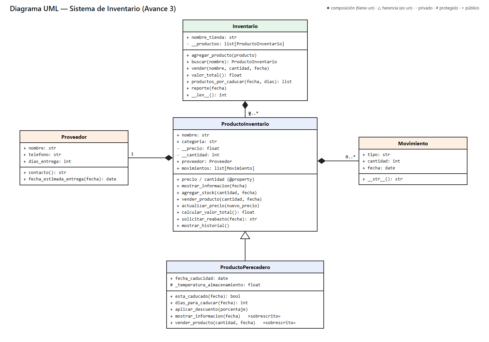

# Sistema de Inventario – Avance 3 Final

**Programación Orientada a Objetos** · José Gabriel Cervantes Mercado

Ampliación del Avance 2 aplicando **composición** (relaciones «tiene-un») y **modularización** (código separado en módulos).

## Estructura

```
Avance_3/
├── modelos.py              # todas las clases (base, subclase y clases de composición)
├── main.py                 # importaciones, creación de objetos y pruebas
└── assets/diagrama_uml.png # diagrama UML actualizado
```

## Qué incluye

- **Composición:**
  - `ProductoInventario` **tiene un** `Proveedor` (`self.proveedor`) y delega en él `contacto()` y el cálculo de la fecha de entrega (`solicitar_reabasto()`).
  - `ProductoInventario` **tiene una lista de** `Movimiento` (`self.movimientos`) donde guarda cada entrada y venta (`mostrar_historial()`).
  - `Inventario` **tiene una lista de** productos (`self.__productos`) y delega en ellos la venta (`vender()`), el valor total y el reporte.
- **Modularización:** `modelos.py` solo define clases; `main.py` solo importa (`from modelos import ...`), crea objetos y ejecuta las pruebas.
- **Herencia:** `ProductoPerecedero` hereda de `ProductoInventario` con `super().__init__()`.
- **Encapsulamiento:** `__precio`, `__cantidad` y `__productos` son privados; los setters rechazan valores negativos.
- **Polimorfismo:** `mostrar_informacion()` y `vender_producto()` se sobrescriben en `ProductoPerecedero`; `Inventario.reporte()` llama el mismo método sobre productos de distinto tipo.

## Ejecutar

```
cd Avance_3
python main.py
```

## Diagrama UML


