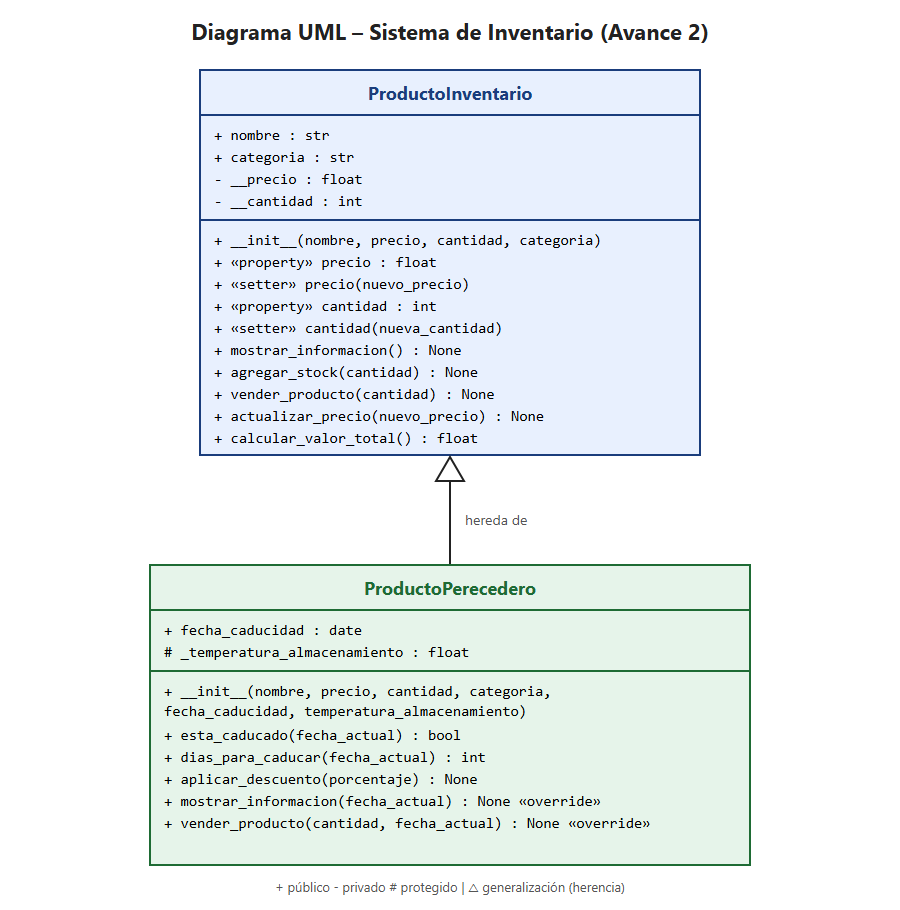

# Sistema de Inventario – Avance 2

**Programación Orientada a Objetos** · José Gabriel Cervantes Mercado

Ampliación del Avance 1 (`ProductoInventario`) aplicando **encapsulamiento**, **herencia** y **polimorfismo**.

## Estructura

```
sistema.py              # código principal
assets/diagrama_uml.png # diagrama UML de la jerarquía de clases
assets/diagrama_uml.svg # mismo diagrama en formato vectorial
```

## Qué incluye

- **Encapsulamiento:** `precio` y `cantidad` son atributos privados (`__precio`, `__cantidad`) con `@property` y setters que rechazan valores negativos.
- **Herencia:** `ProductoPerecedero` hereda de `ProductoInventario`, usa `super().__init__()` y agrega `fecha_caducidad` y `_temperatura_almacenamiento` (protegido).
- **Polimorfismo:** la subclase sobrescribe `mostrar_informacion()` (agrega caducidad y estado) y `vender_producto()` (no permite vender productos caducados).
- **Pruebas:** 3 objetos (1 de la clase base y 2 de la subclase) que demuestran las validaciones, la herencia, los métodos sobrescritos y la independencia de datos entre instancias.

## Ejecutar

```
python sistema.py
```

## Diagrama UML


